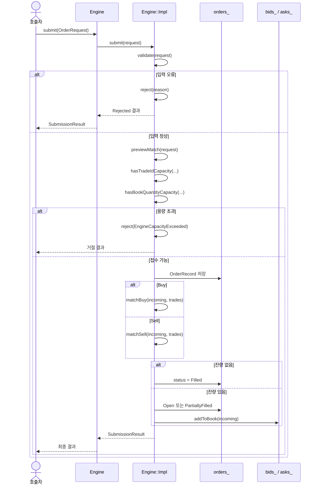
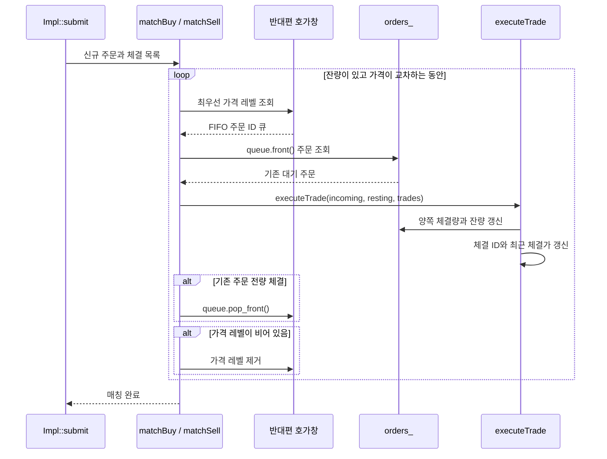
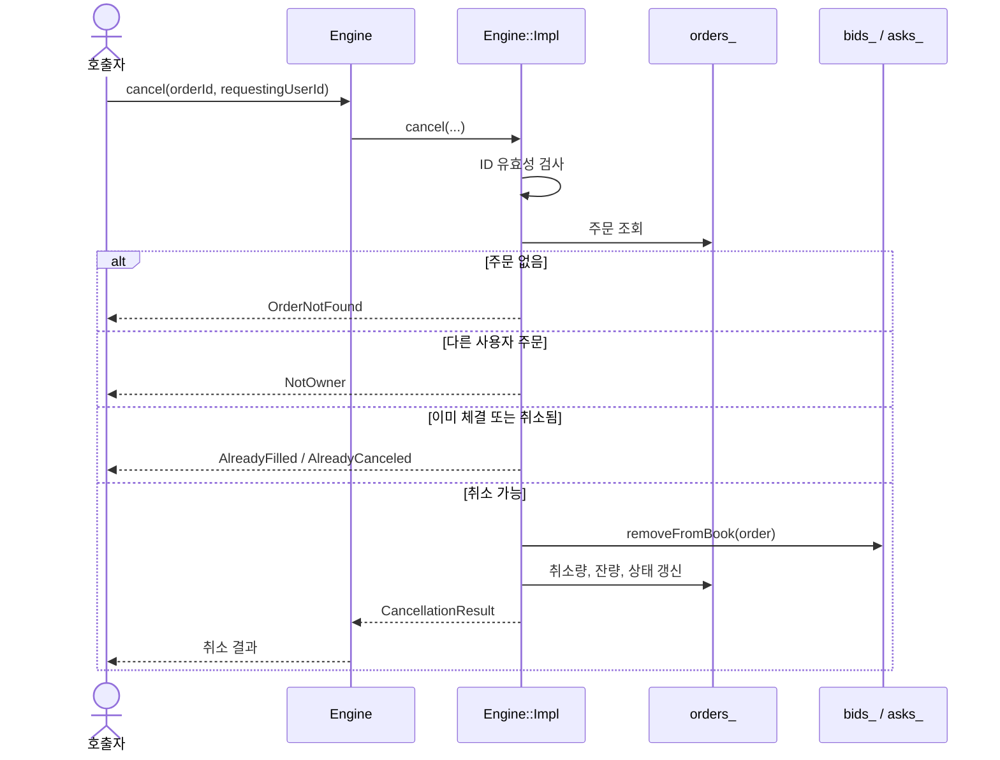
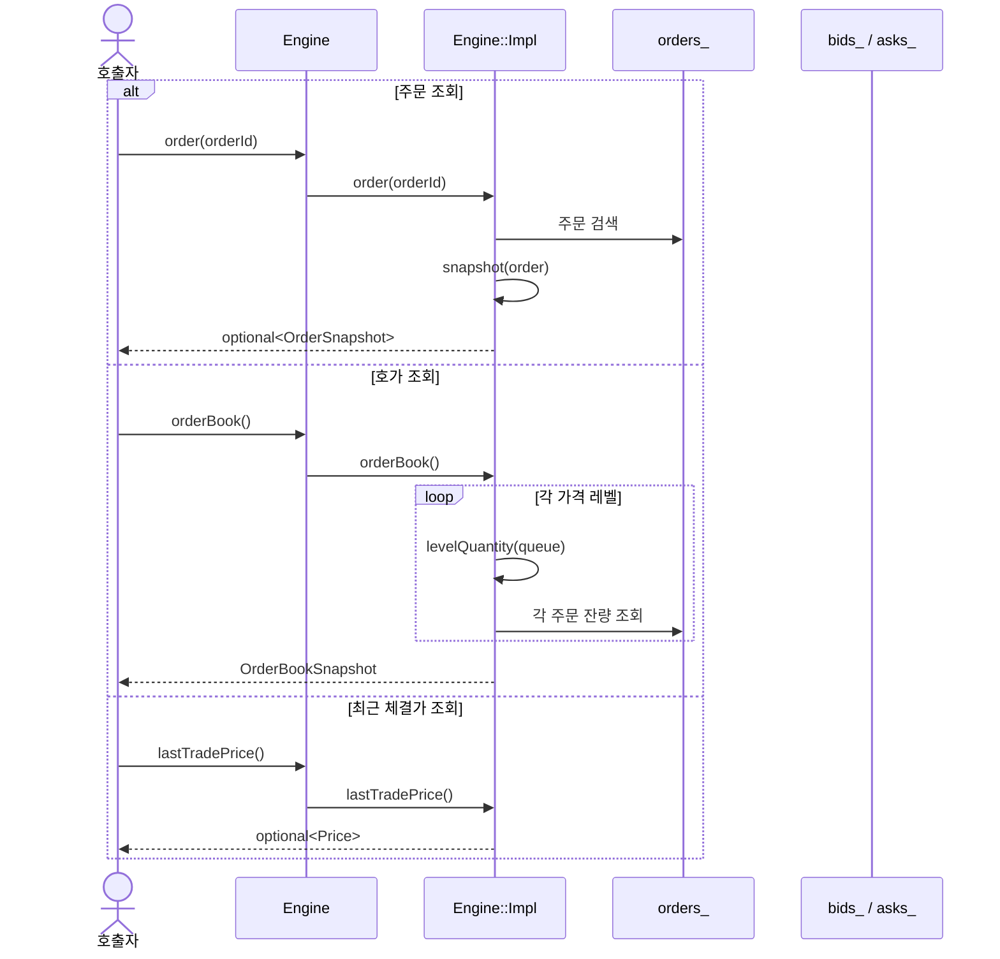
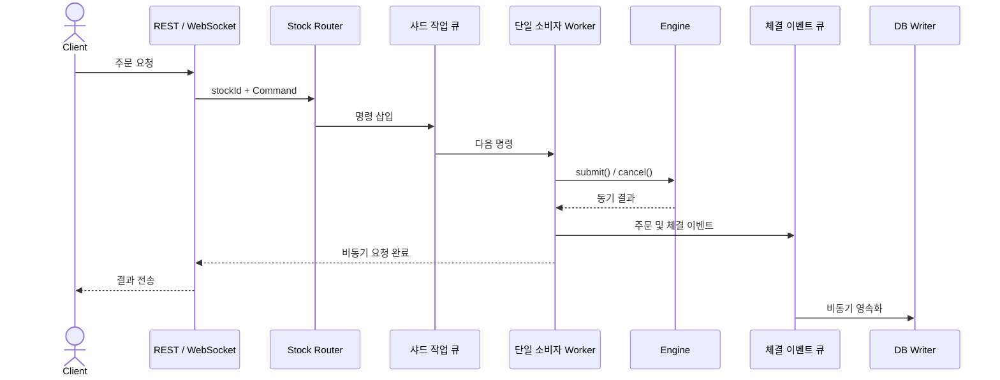

# 매칭 엔진 구조 및 확장 방향

## 1. 현재 구조 요약

현재 엔진은 **인스턴스 하나가 종목 하나를 관리하는, 싱글 스레드 사용을 전제로 한 동기식 인메모리 엔진**이다.

엔진 코어 내부에는 외부 요청 작업 큐가 없다. 새 WebSocket `Router`는 코어 바깥에서
별도 I/O 스레드와 엔진 Worker 스레드를 실행하고, Asio 작업 큐를 통해 주문을 전달한다.
호가 가격별 `std::deque<OrderId>`는 여전히 가격-시간 우선순위를 위한 주문 저장 구조다.
네트워크 실행 계층은 [WebSocket 라우터 문서](websocket-router.md)를 참고한다.

| 구분 | 현재 상태 |
| --- | --- |
| 엔진 단위 | `Engine` 인스턴스 하나당 한 종목 |
| 실행 방식 | 호출한 스레드에서 끝까지 처리하는 동기 방식 |
| 내부 스레드 | 없음 |
| 외부 작업 큐 | `Router`의 엔진 `io_context` 작업 큐 |
| 동일 인스턴스 동시 호출 | 지원하지 않음 |
| 서로 다른 엔진의 병렬 실행 | 호출자가 분리하면 가능 |
| 동기화 장치 | `mutex`, `atomic`, 조건 변수 없음 |
| 상태 저장 | 프로세스 메모리 |
| 영속화 및 복구 | 없음 |

```text
호출자 스레드
    │
    ├─ submit()     입력 검증 → 즉시 매칭 → 상태 변경 → 결과 반환
    ├─ cancel()     권한 검증 → 잔량 제거 → 결과 반환
    ├─ order()      주문 상태를 즉시 조회
    ├─ orderBook()  호가 스냅샷을 즉시 생성
    └─ lastTradePrice() 최근 체결가를 즉시 조회
```

같은 `Engine` 인스턴스에 대한 호출 순서는 호출자가 보장해야 한다. 같은 인스턴스를 여러 스레드에서 동시에 호출하면 내부 컨테이너에 데이터 레이스가 발생할 수 있다.

## 2. 객체 구조

공개 클래스 `Engine`은 PImpl 패턴을 사용한다.

```text
Engine
└─ std::unique_ptr<Engine::Impl>
   ├─ stockId_
   ├─ orders_
   ├─ bids_
   ├─ asks_
   ├─ lastTradePrice_
   └─ nextTradeId_
```

`Engine`은 외부 인터페이스만 노출하고, 실제 주문과 호가창 상태는 `Engine::Impl`이 관리한다. 이 구조는 향후 내부 자료구조를 변경하거나 실행 계층을 추가할 때 공개 헤더에 미치는 영향을 줄인다.

## 3. 공개 입력 타입

### 기본 타입

| 타입 | 실제 타입 | 의미 |
| --- | --- | --- |
| `StockId` | `std::int64_t` | 종목 ID |
| `OrderId` | `std::int64_t` | 주문 ID |
| `UserId` | `std::int64_t` | 참가자 ID |
| `TradeId` | `std::int64_t` | 엔진 내부 체결 ID |
| `Price` | `std::int64_t` | 최소 가격 단위로 표현한 지정가 |
| `Quantity` | `std::int64_t` | 주문수량 |

가격과 주문수량은 실제 주문 검증에서 1 이상 `INT32_MAX` 이하로 제한된다.

### `OrderRequest`

```cpp
struct OrderRequest {
    OrderId orderId;
    UserId userId;
    OrderType type;
    Price price;
    Quantity quantity;
};
```

| 필드 | 의미 | 조건 |
| --- | --- | --- |
| `orderId` | 주문 고유 ID | 양수이며 과거에 접수된 적이 없어야 함 |
| `userId` | 참가자 ID | 양수 |
| `type` | 주문 종류 | `Buy` 또는 `Sell` |
| `price` | 지정가 | 1 이상 `INT32_MAX` 이하 |
| `quantity` | 주문수량 | 1 이상 `INT32_MAX` 이하 |

## 4. 공개 함수

| 함수 | 필요한 인자 | 반환값 | 기능 |
| --- | --- | --- | --- |
| `Engine(stockId)` | 양수 `StockId` | 엔진 객체 | 해당 종목을 담당하는 빈 엔진 생성 |
| `stockId()` | 없음 | `StockId` | 엔진이 담당하는 종목 ID 조회 |
| `submit(request)` | `const OrderRequest&` | `SubmissionResult` | 주문 검증, 즉시 매칭, 잔량 보관 |
| `cancel(orderId, requestingUserId)` | 주문 ID, 요청 사용자 ID | `CancellationResult` | 소유권 확인 후 미체결 잔량 전체 취소 |
| `order(orderId)` | 주문 ID | `optional<OrderSnapshot>` | 접수된 주문의 현재 상태 조회 |
| `orderBook()` | 없음 | `OrderBookSnapshot` | 가격별 매수·매도 잔량 스냅샷 생성 |
| `lastTradePrice()` | 없음 | `optional<Price>` | 실제 마지막 체결 가격 조회 |

### `Engine(StockId stockId)`

엔진이 담당할 종목을 지정한다. `stockId`가 0 이하이면 `std::invalid_argument`를 던진다.

### `submit(const OrderRequest& request)`

신규 지정가 주문을 접수하고 호출 안에서 모든 매칭을 완료한다.

1. 입력값과 주문 ID를 검증한다.
2. 예상 체결 건수와 예상 잔량을 계산한다.
3. 체결 ID 및 호가 수량 오버플로 가능성을 확인한다.
4. 주문을 `orders_`에 기록한다.
5. 매수 주문이면 `matchBuy()`, 매도 주문이면 `matchSell()`을 호출한다.
6. 미체결 잔량이 있으면 `addToBook()`으로 호가창에 추가한다.
7. 접수 상태, 체결량, 잔량과 체결 목록을 반환한다.

### `cancel(OrderId orderId, UserId requestingUserId)`

주문과 요청 사용자를 검증한 뒤 미체결 잔량 전체를 취소한다. 일부 체결 주문은 남은 수량만 취소하며 이미 발생한 체결은 되돌리지 않는다.

### `order(OrderId orderId)`

내부 `OrderRecord`를 조회용 `OrderSnapshot`으로 변환해 반환한다. 주문이 없으면 `std::nullopt`를 반환하며 체결·취소된 주문도 계속 조회할 수 있다.

### `orderBook()`

매수호가는 높은 가격부터, 매도호가는 낮은 가격부터 반환한다. 각 가격의 주문 ID를 순회해 현재 미체결 잔량을 합산한다.

### `lastTradePrice()`

가장 최근에 실제 체결된 가격을 반환한다. 최초 체결 전에는 `std::nullopt`이며 주문 접수나 취소만으로는 값이 바뀌지 않는다.

### 이동과 복사 정책

`Engine`은 이동 생성과 이동 대입을 지원하지만 복사는 금지한다. 따라서 하나의 엔진 상태는 한 `Engine` 객체가 소유한다.

## 5. 주요 내부 함수

| 함수 | 필요한 인자 | 반환값 | 기능 |
| --- | --- | --- | --- |
| `isValidOrderType(type)` | `OrderType` | `bool` | `Buy` 또는 `Sell`인지 검사 |
| `reject(reason)` | 주문 거절 사유 | `SubmissionResult` | 표준 거절 결과 생성 |
| `snapshot(order)` | 내부 주문 레코드 | `OrderSnapshot` | 내부 모델을 공개 조회 모델로 변환 |
| `validate(request)` | 주문 요청 | 거절 사유 | ID, 종류, 가격, 수량, 중복 여부 검사 |
| `previewMatch(request)` | 주문 요청 | `MatchPreview` | 상태 변경 없이 예상 체결 건수와 잔량 계산 |
| `hasTradeIdCapacity(count)` | 예상 체결 건수 | `bool` | 체결 ID 발급 여유 검사 |
| `hasBookQuantityCapacity(...)` | 종류, 가격, 잔량 | `bool` | 가격 레벨 수량 합계 오버플로 검사 |
| `levelQuantity(queue)` | 가격 레벨 주문 ID 큐 | `Quantity` | 해당 가격의 현재 잔량 합산 |
| `matchBuy(incoming, trades)` | 신규 주문, 체결 목록 | 없음 | 최저 매도호가부터 매수 주문 매칭 |
| `matchSell(incoming, trades)` | 신규 주문, 체결 목록 | 없음 | 최고 매수호가부터 매도 주문 매칭 |
| `executeTrade(...)` | 신규 주문, 대기 주문, 체결 목록 | 없음 | 한 건의 체결 생성 및 양쪽 주문 갱신 |
| `addToBook(order)` | 잔량이 있는 주문 | 없음 | 주문을 해당 가격 FIFO 뒤에 추가 |
| `removeFromBook(order)` | 취소할 주문 | 없음 | 가격 레벨에서 주문 ID 제거 |

`models.cpp`의 `toString()` 오버로드들은 주문 종류, 주문 상태, 주문 거절 사유와 취소 실패 사유를 로그나 API 응답에 사용할 문자열로 변환한다.

## 6. 주문 접수 시퀀스



## 7. 실제 매칭 시퀀스



## 8. 취소 시퀀스



## 9. 조회 시퀀스



## 10. 주요 자료구조

### 주문 저장소: `std::unordered_map`

```cpp
std::unordered_map<OrderId, OrderRecord> orders_;
```

모든 접수 주문의 실제 상태를 저장한다. 체결 또는 취소된 주문도 삭제하지 않아 상태 조회와 주문 ID 재사용 방지에 사용하며 평균 ID 조회 비용은 `O(1)`이다.

### 가격별 호가창: 정렬된 `std::map`

```cpp
using BidBook =
    std::map<Price, std::deque<OrderId>, std::greater<Price>>;

using AskBook =
    std::map<Price, std::deque<OrderId>, std::less<Price>>;
```

- `BidBook`은 높은 가격부터 정렬되므로 `begin()`이 최고 매수호가다.
- `AskBook`은 낮은 가격부터 정렬되므로 `begin()`이 최저 매도호가다.
- 가격 레벨 탐색과 삽입 비용은 `O(log P)`이며 `P`는 가격 레벨 수다.

### 가격 내 우선순위: `std::deque<OrderId>`

각 가격 레벨에서 주문 ID를 접수 순서대로 저장한다.

```text
가격 10,000
front                                         back
┌────────────┬────────────┬────────────┐
│ 첫 번째 주문 │ 두 번째 주문 │ 세 번째 주문 │
└────────────┴────────────┴────────────┘
```

- 신규 대기 주문은 `push_back()`으로 추가한다.
- 다음 체결 대상은 `front()`에서 가져온다.
- 전량 체결 주문은 `pop_front()`로 제거한다.

이 `deque`는 비동기 작업 큐가 아니라 같은 가격에서 시간 우선순위를 유지하는 호가 내부 자료구조다.

### 구현 은닉: `std::unique_ptr<Engine::Impl>`

엔진 상태의 단일 소유권을 보장하고 실제 자료구조를 공개 헤더에서 숨긴다. 복사는 금지하고 이동만 허용한다.

### 값 부재 표현: `std::optional`

존재하지 않는 주문, 최초 체결 전 최근 체결가와 체결 ID 소진 상태를 특수 숫자 대신 명시적으로 표현한다.

### 다중 체결 결과: `std::vector<Trade>`

신규 주문 하나가 여러 대기 주문과 체결될 수 있으므로 발생 순서대로 체결 목록을 저장한다.

## 11. 주요 연산 비용

| 연산 | 대략적인 비용 | 비고 |
| --- | --- | --- |
| 주문 ID 조회 | 평균 `O(1)` | `unordered_map` |
| 가격 레벨 탐색·삽입 | `O(log P)` | 정렬된 `map` |
| 동일 가격 주문 추가 | `O(1)` | `deque::push_back()` |
| 최우선 주문 확인 | `O(1)` | `map::begin()`, `deque::front()` |
| 주문 취소 | `O(log P + Q)` | 해당 가격 큐에서 주문 ID 선형 검색 |
| 주문 상태 조회 | 평균 `O(1)` | 주문 ID 조회 |
| 전체 호가 스냅샷 | `O(A)` | 모든 활성 주문 잔량을 합산 |

`P`는 가격 레벨 수, `Q`는 한 가격에 대기 중인 주문 수, `A`는 전체 활성 주문 수다.

## 12. 비동기·멀티스레드 확장 가능성

### 결론

현재 구조는 **비동기 서버의 동기식 매칭 코어로 확장하기 적합하다**. 엔진 내부를 비동기로 바꾸기보다는 외부에 라우터, 작업 큐와 Worker를 추가하고 엔진 자체는 순차 실행으로 유지하는 방식이 권장된다.

| 확장 방식 | 현재 가능 여부 | 필요한 조치 |
| --- | --- | --- |
| 서로 다른 엔진을 서로 다른 스레드에서 실행 | 가능 | 인스턴스를 스레드 간 공유하지 않음 |
| 같은 엔진을 여러 스레드에서 직접 호출 | 불가능 | 락 또는 직렬화 계층 필요 |
| 비동기 API에서 엔진 호출 | 가능 | 명령 큐와 비동기 응답 연결 필요 |
| 여러 종목을 병렬 처리 | 가능 | 종목별 또는 샤드별 Worker 필요 |

### 권장 실행 구조



핵심 원칙은 다음과 같다.

```text
네트워크 입출력은 비동기
동일 종목의 명령은 순차 처리
매칭 엔진 코어는 동기 실행
서로 다른 종목 또는 샤드는 병렬 처리
```

### 종목별 스레드와 샤딩

종목 수가 많을 때 종목마다 스레드를 하나씩 생성할 필요는 없다. 고정된 수의 Worker에 종목을 분배하는 샤딩 구조가 적합하다.

```cpp
workerIndex = hash(stockId) % workerCount;
```

같은 `stockId`가 항상 같은 Worker로 전달되면 주문 순서를 유지하면서 다른 종목은 병렬 처리할 수 있다.

```text
Worker 0: Stock 1001, Stock 1005, Stock 1010
Worker 1: Stock 1002, Stock 1007
Worker 2: Stock 1003, Stock 1008
```

### 같은 엔진을 직접 공유하는 방식

엔진 외부에 `mutex`를 두면 여러 스레드의 직접 호출을 직렬화할 수는 있다. 하지만 API 스레드가 매칭 완료까지 대기하고 호출 순서 관리가 어려워질 수 있으므로, 서버 구조에서는 단일 소비자 작업 큐가 더 적합하다.

### 확장 시 필요한 구성요소

- `SubmitCommand`, `CancelCommand`, `QueryCommand` 같은 명령 모델
- 다종목 `stockId` 기반 라우터 (현재 단일 등록 종목 검증 구현)
- 샤드별 다중 생산자·단일 소비자 작업 큐 (현재 단일 Worker의 Asio 작업 큐 구현)
- 요청 ID, `promise/future`, 코루틴 또는 응답 큐를 이용한 결과 연결
- 주문 및 체결 이벤트 발행
- 비동기 DB Writer와 WebSocket 알림 계층
- Worker 종료, 대기 명령 처리와 장애 복구 정책
- 이벤트 로그 또는 WAL과 엔진 상태 스냅샷

조회에 강한 일관성이 필요하면 조회 명령도 같은 큐에서 처리한다. 더 빠른 조회가 필요하면 Worker가 불변 호가 스냅샷을 발행하도록 만들 수 있지만 최신 주문과 약간의 시차가 생길 수 있다.

## 13. 최종 정리

현재 구조를 정확히 표현하면 다음과 같다.

> 하나의 `Engine`이 하나의 종목을 관리하며, 호출자가 순차적으로 호출하는 싱글 스레드 전제의 동기식 매칭 엔진이다. WebSocket 서버에서는 `Router`의 단일 엔진 Worker가 외부 Asio 작업 큐를 소비하며 엔진을 호출한다.

현재 비동기 WebSocket 주문 API와 단일 종목 실행 계층을 구현했다. 향후에는 기존 매칭 코어를 유지하면서 다종목 라우팅, 샤드별 작업 큐와 Worker를 추가하는 방식으로 확장할 수 있다.
