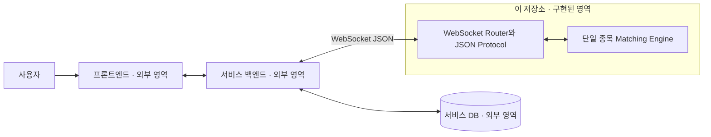
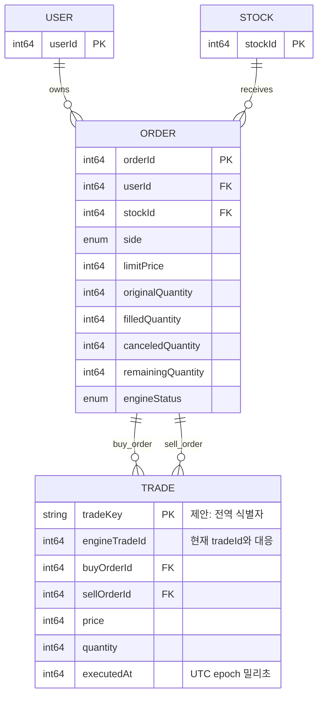
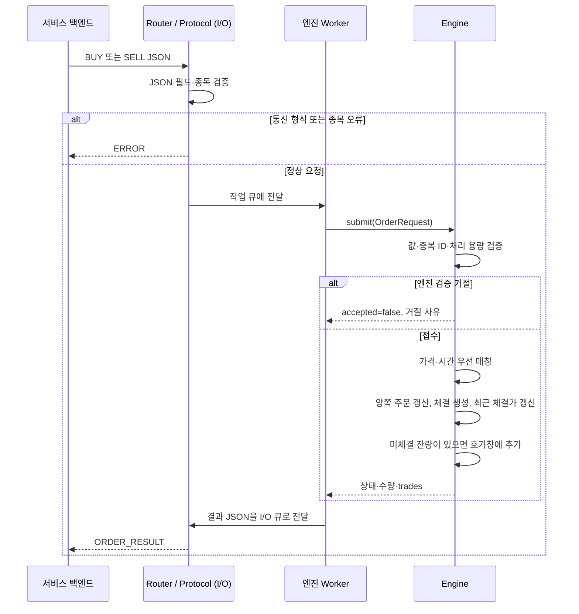

# 매칭 엔진 모듈 정리 — 서비스 통합 설계용

> 노션 저장용 사본. 원본: `docs/module-handoff.md`
> 원문의 기능 설명·표·JSON 예제·Mermaid 다이어그램·AI 전달용 요청문을 유지했다. 저장소 상대 링크는 문서명과 저장소 기준 경로로 표기했다.

작성 기준: 2026-11-03, 현재 저장소의 소스 코드와 공개 인터페이스.

이 문서는 다른 백엔드·프론트엔드 자료와 함께 사람 또는 AI에게 전달할 수 있는 설계 입력 자료다. 정보 모델링, Use Case, Sequence Diagram, 1차 ERD, 역할·마일스톤, 기술 스택을 작성할 때 이 저장소가 담당하는 범위와 연결 조건을 제공한다.

**구현 상태 표기**

- **구현 · 외부 연동 가능**: WebSocket 요청으로 사용할 수 있다.
- **구현 · 내부 함수만 제공**: C++ 함수는 있지만 WebSocket API는 없다.
- **제안 / 미구현 / 미확정**: 통합 설계에 필요한 후보이며 완료된 기능이 아니다.

다른 백엔드·프론트엔드의 코드, 실제 팀원, 제출 일정은 이 문서에서 확인하지 않았다. 외부 영역의 구조와 역할 분담은 제안이며, 전체 서비스의 확정 설계로 해석하지 않는다.

## 1. 프로젝트를 한 문장으로 설명하면

**사용자의 지정가 매수·매도 주문을 받아 가격과 접수 순서에 따라 거래를 체결하고, 미체결 주문과 최근 체결가를 메모리에서 관리하는 C++ 서비스다.**

예를 들어 A가 10,100에 7주를 팔겠다고 등록한 뒤, B가 10,200 이하로 3주를 사겠다고 요청하면 10,100에 3주가 체결된다. A의 주문은 4주가 남고, B의 주문은 완료된다. 체결 가격은 먼저 대기하던 주문의 가격이다. 이 숫자의 화폐 단위는 서비스에서 별도로 정한다.

### 전체 서비스에서의 위치



외부 영역은 권장 연결 구조다. 프론트엔드와 서비스 백엔드 사이의 통신 방식은 이 저장소에서 결정하지 않는다. 현재 엔진에는 인증과 잔고 검증이 없으므로, 사용자 요청을 검증한 서비스 백엔드가 엔진을 호출하는 역할 분담을 전제로 통합한다.

| 영역 | 담당할 책임 | 현재 저장소의 구현 여부 |
| --- | --- | --- |
| 프론트엔드 | 주문 입력, 주문 상태·체결 결과·현재가 표시 | 미포함 |
| 서비스 백엔드 | 인증, 사용자 확인, 주문 ID 발급, 잔고·보유량 검증, 자산 예약, DB 저장, 체결 정산, 화면 갱신 전달 | 미포함; 외부 담당 제안 |
| 매칭 서비스 | 주문 형식 검증, 매칭, 호가·주문 상태 관리, 잔량 취소, 최근 체결가 조회 | 아래 모듈별 상태 참고 |

## 2. 모듈 목록

아래는 **기능 기준의 논리 모듈**이다. M02~M05는 별도 서버가 아니라 같은 `Engine` 클래스 안에 구현되어 있다.

| ID | 모듈 | 역할 | 입력 → 출력 | 상태 | 주요 구현 위치 |
| --- | --- | --- | --- | --- | --- |
| M01 | 통신·프로토콜 | 연결 수락, JSON 검증·변환, 종목 확인, 요청 전달, 응답 직렬화 | WebSocket JSON → 엔진 요청 → 결과 JSON | 구현 · 외부 연동 가능 | `router/src/router.cpp`, `router/src/order_protocol.cpp` |
| M02 | 신규 주문·매칭 | 주문 검증, 가격·시간 우선 체결, 부분·연속 체결 | `OrderRequest` → `SubmissionResult`, `Trade[]` | 구현 · 외부 연동 가능 | `engine/src/engine.cpp`의 `submit`, `matchBuy`, `matchSell`, `executeTrade` |
| M03 | 주문 상태·호가 관리 | 주문별 수량과 상태 유지, 가격별 대기 잔량 조회 | 주문 ID / 조회 호출 → 주문·호가 스냅샷 | 구현 · 내부 함수만 제공 | `Engine::order`, `Engine::orderBook` |
| M04 | 주문 취소 | 요청자와 주문 소유자 비교, 미체결 잔량 전체 취소 | 주문 ID·사용자 ID → 성공 여부·취소량·실패 사유 | 구현 · 외부 연동 가능 | `Engine::cancel` |
| M05 | 현재가 | 가장 최근에 실제 체결된 가격 조회 | 종목 ID → 가격 또는 `null` | 구현 · 외부 연동 가능 | `Engine::lastTradePrice`, `currentPriceResult` |
| M06 | 실행·처리 순서 관리 | 서버 시작·종료, I/O와 엔진 작업 분리, 엔진 순차 호출 | 실행 설정·신호 → 서버와 스레드 수명 관리 | 구현 · 실행 계층 | `app/server.cpp`, `Router::Impl` |
| M07 | 검증·개발 도구 | 코어 규칙과 WebSocket 연동 검증, 로컬 데모 | 테스트 시나리오 → 검증 결과 | 구현 · 개발용 | `tests/engine_test.cpp`, `tests/router_test.cpp`, `app/main.cpp` |

### M01. 통신·프로토콜

- WebSocket text 메시지 하나를 JSON 객체 하나로 해석한다. 요청 종류는 `type`, 응답 종류는 `event`로 구분한다.
- 요청마다 정해진 필드를 정확히 요구한다. 임의의 `requestId`, `roomId`, 인증 토큰, 추가 필드는 현재 허용하지 않는다.
- 서버에 설정된 `stockId`와 다른 종목은 `UNKNOWN_STOCK`으로 거절한다. 현재 Router 하나는 Engine 하나와 종목 하나만 관리한다.
- 결과는 요청한 연결로만 보낸다. 다른 주문 소유자에게 보내는 체결 알림, 구독, 방송 기능은 없다.
- 기본 설정: `127.0.0.1:9002`, `stockId=1001`, 메시지 최대 16 KiB, 연결 최대 128개. 인증·TLS는 미구현이다.
- **연동 담당자가 할 일:** 정해진 JSON을 만들고, 요청별 결과를 서비스 DB와 화면 상태에 반영한다.

### M02. 신규 주문·매칭

- 지정가 매수(`BUY`)와 지정가 매도(`SELL`)만 지원한다.
- 매수는 지정가 이하의 가장 낮은 매도호가부터, 매도는 지정가 이상의 가장 높은 매수호가부터 체결한다.
- 같은 가격에서는 엔진에 먼저 접수되어 대기한 주문이 우선한다. 사용자 기기의 요청 시각이나 DB 생성 시각을 비교하지 않는다.
- 한 번의 체결 수량은 두 주문의 잔량 중 작은 값이고, 체결 가격은 기존 대기 주문의 가격이다.
- 한 주문이 여러 주문과 체결될 수 있다. 남은 수량은 원래 지정가의 대기열 뒤에 넣는다.
- ID·방향·가격·수량·중복 주문 ID·내부 수량 및 체결 ID 용량을 검사한다. 명시적인 검증 거절은 엔진 상태를 바꾸지 않는다.
- 접수된 주문 ID는 체결·취소 후에도 같은 엔진 수명 안에서 재사용할 수 없다. 거절된 ID는 수정하여 다시 사용할 수 있다.
- **연동 담당자가 할 일:** 주문 ID를 발급하고, 자산을 검증·예약하며, 반환된 모든 체결을 양쪽 주문과 계좌에 반영한다.

### M03. 주문 상태·호가 관리

- 주문 원수량, 누적 체결량, 누적 취소량, 현재 잔량, 상태를 메모리에 보관한다. 체결·취소된 주문도 엔진이 살아 있는 동안 조회할 수 있다.
- `order(orderId)`는 주문 스냅샷 또는 미등록이면 `nullopt`를 반환한다.
- `orderBook()`은 내부 `PriceLevel`에 유지되는 가격별 잔량 합계(`PriceQuantity`)를 읽는다. 합계는 0에서 시작해 대기 주문 추가 시 증가하고 체결·취소 시 감소한다. 매수호가는 가격 내림차순, 매도호가는 오름차순이다.
- **제약:** 현재 두 조회 함수의 WebSocket API는 없다. 화면의 호가창·주문 상세 조회를 구현 완료라고 표현하면 안 된다.
- **확장 후보:** 조회 API 또는 스냅샷·변경 이벤트 전달 규약을 추가하고 프론트엔드 갱신 방식과 맞춘다.

### M04. 주문 취소

- 남아 있는 활성 잔량 전체를 취소한다. 일부 수량만 선택하는 취소나 이미 체결된 거래의 취소는 지원하지 않는다.
- 검사 순서: ID 유효성 → 주문 존재 → 요청자 소유 여부 → 전량 체결·취소 여부.
- 일부 체결된 주문의 잔량을 취소하면 상태는 `Canceled`가 되며 기존 체결량은 유지한다.
- **연동 담당자가 할 일:** 로그인 사용자에 대응하는 `userId`를 전달하고, 성공한 `canceledQuantity`를 기준으로 예약 자산 해제를 처리한다.
- 소유자 ID 비교는 구현되어 있지만, 전달된 ID가 실제 로그인 사용자인지 인증하는 기능은 없다.

### M05. 현재가

- 현재가는 **이 엔진에서 발생한 가장 최근 체결의 가격**이다. 외부 주식시장 시세, 주문 지정가, 매수·매도 중간값이 아니다.
- 최초 체결 전에는 `null`이다. 주문 대기·거절·취소만으로는 바뀌지 않는다.
- 여러 건이 연속 체결되면 마지막 체결의 가격이 현재가가 된다.
- 요청할 때 한 번 응답한다. 자동 푸시, 가격 이력, 캔들 생성은 없다.

### M06. 실행·처리 순서 관리

- 코어는 호출한 스레드에서 동기 실행하며 자체 스레드와 락이 없다.
- Router가 I/O 스레드 하나와 엔진 Worker 스레드 하나를 만들고 Asio 작업 큐로 연결한다. main 스레드는 종료 신호를 기다린다.
- 신규 주문·취소·현재가 조회를 같은 Worker에서 순차 실행한다. 취소와 체결이 겹치면 실제 처리 순서에 따라 결과가 달라진다.
- 같은 연결은 응답 전송 완료 후 다음 요청을 읽는다. 다른 연결의 요청도 같은 엔진 작업 큐에서 처리한다.
- 종료 시 새 입력과 연결을 닫고 이미 엔진 큐에 전달된 작업을 처리한 뒤 스레드를 정리한다. 종료 중 응답 전달은 보장하지 않는다.
- 프로세스가 종료되면 주문·호가·최근 체결가가 사라진다. 재시작 복구는 없다.

### M07. 검증·개발 도구

- 엔진 단위 테스트: 입력 검증, 주문 ID 정책, 매수·매도 가격·시간 우선순위, 연속·부분 체결, 호가 집계, 취소, 최근 체결가.
- 실제 로컬 WebSocket 통합 테스트: 주문·취소·현재가, JSON 검증, 여러 연결, 순서 보장, 중복 ID, 취소·체결 경합, 서버 수명과 연결·메시지 제한.
- 개발 빌드와 테스트 명령: `cmake --build --preset dev`, `ctest --preset dev`.
- 이 테스트는 외부 백엔드의 DB 정산이나 프론트엔드 동작을 검증하지 않는다.

## 3. 정보 모델링과 1차 ERD에 사용할 개념

### 용어와 데이터 소유권

| 개념 | 의미와 주요 속성 | 현재 보관 형태 | 통합 시 주의할 점 |
| --- | --- | --- | --- |
| 사용자 / 참가자 | 주문 소유자 `userId` | 주문 안의 ID만 보관 | 사용자·회원·방 참가자 중 어느 엔티티인지 외부 모델과 확정 필요 |
| 종목 | 주문이 거래되는 대상 `stockId` | Engine 설정값 | 종목명·코드·기준가 등 종목 마스터는 없음 |
| 주문 | `orderId`, `userId`, 방향, 지정가, 원수량, 체결량, 취소량, 잔량, 상태 | `orders_`에 저장 | `stockId`는 엔진에 귀속되며 코어 `OrderRequest`에는 없음. 통신에는 포함 |
| 체결 | `tradeId`, `buyOrderId`, `sellOrderId`, 체결가, 체결량, `executedAt` (UTC epoch 밀리초 정수) | 신규 주문 결과의 `trades`로 반환 | 독립적인 체결 이력 저장소·조회 API는 없음. 외부에서 저장 필요 |
| 호가 레벨 | 매수/매도 방향, 가격, 해당 가격의 잔량 합계 | 내부 `PriceLevel`의 `PriceQuantity`를 주문 추가·체결·취소 시 갱신 | 조회용 파생 모델. 반드시 별도 DB 테이블이어야 하는 것은 아님 |
| 현재가 | 종목의 최근 실제 체결 가격, 최초에는 없음 | `optional<Price>` | 조회용 상태. 체결 이력·외부 시세와 구분 |

ID는 양수 signed int64, 신규 지정가와 주문수량은 `1..2,147,483,647` 범위의 정수다. 내부 가격·수량 타입은 int64다. 가격은 시스템이 정한 최소 가격 단위의 개수이며, 엔진은 `price × quantity` 금액 계산을 하지 않는다.

JavaScript와 연결할 때에는 큰 int64 ID의 정밀도 보존 방식을 합의해야 한다. 현재 엔진 프로토콜은 문자열 ID를 받지 않는다.

### 주문 상태 모델

| 코어 상태 | JSON의 `engineStatus` | 신규 주문 결과의 `status` | 의미 |
| --- | --- | --- | --- |
| `Open` | `OPEN` | `PENDING` | 미체결 대기 |
| `PartiallyFilled` | `PARTIALLY_FILLED` | `PENDING` | 일부 체결, 잔량 대기 |
| `Filled` | `FILLED` | `COMPLETE` | 전량 체결 |
| `Canceled` | 신규 주문 응답에는 없음 | 신규 주문 응답에는 없음 | 미체결 잔량 취소; 별도 `CANCEL_RESULT`로 통지 |
| `Rejected` | `REJECTED` | `null` | 접수 거절; 엔진 주문 이력에 저장되지 않음 |

접수된 주문에는 다음 관계가 성립한다.

```text
원주문 수량 = 누적 체결량 + 누적 취소량 + 현재 대기 잔량

신규 주문 → Open / PartiallyFilled / Filled
Open → PartiallyFilled / Filled / Canceled
PartiallyFilled → PartiallyFilled / Filled / Canceled
검증 실패 → Rejected (저장된 주문의 상태 전이가 아닌 요청 결과)
```

### 1차 ERD 후보 — DB 미구현, 통합용 논리 관계



- 사용자 하나와 종목 하나에 여러 주문이 연결된다. 체결 하나에는 매수 주문 하나와 매도 주문 하나가 연결되며, 주문 하나는 여러 체결에 참여할 수 있다.
- `side`, `limitPrice`, `engineTradeId`는 의미를 분명히 하기 위한 ERD 후보 이름이다. 현재 통신 필드명은 각각 `type`, `price`, `tradeId`다.
- 그림의 `ORDER.orderId` 전역 PK는 **외부 백엔드에서 전역 유일 ID를 발급한다는 제안**이다. 엔진이 보장하는 중복 검사는 인스턴스 수명 안으로 한정된다.
- 엔진의 `tradeId`는 새 Engine마다 1부터 시작한다. 이를 그대로 전체 서비스의 전역 PK로 쓰면 충돌할 수 있다. `tradeKey`는 현재 없는 제안 필드이며, 전역 ID 또는 엔진 실행 식별자와 체결 순번의 조합을 별도로 설계해야 한다. `stockId + tradeId`만으로는 재시작 충돌을 해결하지 못한다.
- 실제 DB 테이블과 마이그레이션은 없다. 위 그림을 구현된 DB 구조라고 설명하지 않는다.
- 체결 시각 `executedAt`은 엔진이 각 체결 생성 시 서버 시스템 시계로 기록하며, `1970-01-01T00:00:00Z`부터 경과한 밀리초 정수(int64)로 반환한다.
- 주문 생성·접수 시각, 방/게임 ID, 계좌, 보유 주식, 예약 자산, 수수료 필드는 현재 코어에 없다. 다른 파트의 모델과 합쳐 필요성과 소유권을 결정한다.
- 호가와 현재가는 주문·체결에서 얻는 파생 정보다. 별도 테이블·캐시 사용 여부는 미확정이다.

## 4. Use Case 작성용 목록

시스템 경계를 **매칭 서비스**로 잡으면 직접 액터는 서비스 백엔드다. 시스템 경계를 **전체 거래 서비스**로 잡으면 사용자가 주문·취소·조회 Use Case의 액터가 되고, 엔진은 내부 구성요소가 된다.

| ID | Use Case | 직접 액터 | 전제 / 입력 | 정상 결과 | 주요 대안·실패 | 관련 모듈 |
| --- | --- | --- | --- | --- | --- | --- |
| UC01 | 지정가 매수·매도 주문 | 서비스 백엔드 | 등록 종목, 신규 주문 ID, 사용자 ID, 방향·가격·수량 | 접수 후 미체결·부분 체결·전량 체결 중 하나, 체결 목록 | 형식 오류, 미등록 종목, 값 오류, 중복 주문 ID | M01, M02, M03, M05, M06 |
| UC02 | 미체결 잔량 취소 | 서비스 백엔드 | 종목·주문·요청 사용자 ID | 잔량 전체 취소, 취소량 반환 | 주문 없음, 타인 주문, 이미 체결·취소 | M01, M03, M04, M06 |
| UC03 | 현재가 조회 | 서비스 백엔드 | 등록 종목 ID | 최근 체결가 또는 최초 체결 전 `null` | 형식 오류, 미등록 종목 | M01, M05, M06 |
| UC04 | 주문 상태 조회 | C++ 호출자 | 주문 ID, 같은 엔진의 순차 호출 보장 | 주문 스냅샷 또는 미등록 | 외부 API 없음 | M03 |
| UC05 | 호가 조회 | C++ 호출자 | 같은 엔진의 순차 호출 보장 | 가격별 매수·매도 잔량 | 외부 API 없음 | M03 |
| UC06 | 서버 시작·종료 | 실행 담당자 | 주소·포트·종목 설정, 종료 신호 | 요청 처리 시작 또는 종료 정리 | 포트 바인딩 실패, 설정 오류 | M06 |

자동 매칭은 UC01의 내부 동작이다. 사용자에게 별도의 ‘체결 실행’ 액션이 있다고 모델링할 필요는 없다.

## 5. Sequence Diagram 작성용 흐름

### 구현된 신규 주문 처리



### 구현된 취소·현재가 흐름

```text
취소:
백엔드 → Router: CANCEL_ORDER(stockId, orderId, userId)
Router → Worker → Engine.cancel(): 소유자·상태 검사 후 잔량 제거
Engine → Worker → Router → 백엔드: CANCEL_RESULT(success, canceledQuantity, failureReason)

현재가:
백엔드 → Router: GET_CURRENT_PRICE(stockId)
Router → Worker → Engine.lastTradePrice(): 최근 체결가 읽기
Engine → Worker → Router → 백엔드: CURRENT_PRICE(stockId, price | null)
```

취소가 큐에 도착하기 전에 주문이 전량 체결되면 `ALREADY_FILLED`가 된다. 화면에서 취소 버튼을 눌렀다는 사실만으로 취소 성공을 확정하지 않는다.

### 전체 서비스로 합칠 때 추가할 단계 — 제안, 이 저장소에는 미구현

1. 사용자 → 프론트엔드: 주문 입력.
2. 프론트엔드 → 서비스 백엔드: 사용자 주문 요청.
3. 서비스 백엔드: 인증 사용자 확인, 잔고·보유량 검사, 자산 예약, 주문 ID 발급·주문 기록.
4. 서비스 백엔드 ↔ 매칭 서비스: 위 신규 주문 시퀀스 실행.
5. 서비스 백엔드: 반환된 `trades` 각각에 대해 **매수·매도 양쪽 주문**을 갱신하고 체결 저장·계좌 정산.
6. 서비스 백엔드 → 프론트엔드: 주문·잔고·체결 결과 갱신 전달.

3~6단계를 하나의 원자적 트랜잭션으로 처리하는 기능은 없다. 거절 시 예약 해제, 응답 유실 시 결과 확인, DB 반영 실패 시 복구, 중복 정산 방지를 통합 설계에서 정해야 한다.

## 6. 외부 인터페이스 요약

| 요청 `type` | 정확한 요청 필드 | 응답 `event` | 결과 판단 |
| --- | --- | --- | --- |
| `BUY` / `SELL` | `type`, `stockId`, `orderId`, `userId`, `status`, `price`, `quantity` | `ORDER_RESULT` | `accepted`, `engineStatus`, 수량, `trades` |
| `CANCEL_ORDER` | `type`, `stockId`, `orderId`, `userId` | `CANCEL_RESULT` | `success`, `canceledQuantity`, `failureReason` |
| `GET_CURRENT_PRICE` | `type`, `stockId` | `CURRENT_PRICE` | `price`는 정수 또는 `null` |
| 형식·종목 오류, 내부 예외 | 해당 요청 | `ERROR` | `code`, `message` |

신규 주문의 `status`는 반드시 `PENDING`이다. `accepted=true`는 접수 성공이지 전량 체결을 뜻하지 않는다. `ORDER_RESULT`와 `CANCEL_RESULT`도 실패를 담을 수 있다.

```json
{"type":"BUY","stockId":1001,"orderId":1001,"userId":10,"status":"PENDING","price":10200,"quantity":3}
```

```json
{"type":"CANCEL_ORDER","stockId":1001,"orderId":1001,"userId":10}
```

```json
{"type":"GET_CURRENT_PRICE","stockId":1001}
```

전체 응답 예제와 오류 코드는 백엔드 JSON 통신 명세 (`docs/backend-json-api.md`)를 사용한다. 새로운 REST 경로나 WebSocket 요청 종류를 이미 존재하는 API로 만들지 않는다.

## 7. 통합 설계에서 반드시 구분할 제약과 결정 사항

| 항목 | 현재 사실 | 통합 시 결정할 내용 |
| --- | --- | --- |
| 상대방 주문의 갱신 | 새 주문 요청에 체결 목록을 반환하고 상대방 연결에는 알리지 않음 | 백엔드가 `buyOrderId`·`sellOrderId`로 양쪽 주문을 갱신하고 사용자에게 전달하는 방식 |
| 결과 유실과 재시도 | 처리 후 연결이 끊겨도 체결은 되돌아가지 않음. 중복 ID는 거절되며 원래 응답 재전송 기능은 없음 | 결과 확인·재처리 정책. 중복 방지와 멱등 응답 재현을 구분 |
| 내부 예외 | `INTERNAL_ERROR` 시 주문·취소 결과가 불확실할 수 있음 | 실패를 미접수로 단정하지 않고 결과를 확인하는 경로 |
| 저장과 복구 | 모두 메모리 상태, 영속 로그·복구 없음 | DB 저장 주체와 엔진 재시작 복원 방식 |
| 사용자 신원 | `userId` 값과 취소 소유자만 검사 | 인증된 사용자와 엔진 ID의 연결 |
| 주문 상태 | `PENDING`이 미체결과 부분 체결을 모두 포함 | DB·화면에서 상세 상태와 취소·거절을 표현하는 방식 |
| 자기체결 | 같은 사용자 사이의 매수·매도도 체결 가능 | 자기체결 허용 또는 방지 정책 |
| 종목·방 구분 | Router 하나당 한 종목, `roomId` 없음 | 다종목 라우팅, 같은 종목의 방별 호가창 분리 필요 여부 |
| 시각·가격 단위 | `executedAt`: 서버 시스템 시계 기준 UTC epoch 밀리초 정수, 가격은 최소 단위 정수 | 추가로 기록할 주문 시각, 금액·호가 단위 |
| 화면 조회 | 주문·호가 조회는 내부 함수만, 현재가는 요청 응답만 | 조회 API 확장과 화면 갱신 방식 |

시장가·정정·조건부 주문, 만료, 수수료, 호가 단위표, 가격 제한폭, 외부 시세, 봇, 게임/방 스케줄링은 현재 구현 범위에 없다.

## 8. 역할 분담과 마일스톤 입력 자료

### 역할 분담 초안

실제 담당자 이름과 인원은 미확정이다. 아래는 기술 경계에 따른 책임 제안이며 여러 역할을 한 사람이 맡을 수 있다.

| 역할 | 담당 범위 | 협업 산출물 |
| --- | --- | --- |
| 매칭 엔진 담당 | M02~M05, 매칭 규칙·주문 상태·조회 확장 | 엔진 명세, 데이터 모델, 단위 테스트 |
| 통신·연동 담당 | M01·M06, JSON 계약, 순서·오류·연결 수명 | 통신 명세, 연동 테스트, 실행 설정 |
| 서비스 백엔드 담당 | 인증, 주문 ID, 예약·정산, DB, 양쪽 주문 반영 | 서비스 API, ERD, 정산·복구 규칙 |
| 프론트엔드 담당 | 주문·취소 입력, 상태·체결·가격·호가 표시 | 화면 흐름, 상태 표현, 연동 검증 |
| 공통 설계·검증 담당 | 용어·ID·상태 합의, 시나리오·일정 관리 | 통합 Use Case, Sequence Diagram, E2E 검증 결과 |

### 마일스톤 초안

현재 구현으로 확인된 범위는 매칭 코어, 주문·취소·현재가 WebSocket API, 로컬 단위·통합 테스트다. 다음 표는 **앞으로의 통합 작업 순서 제안**이다. 시작일·마감일·소요 기간·담당자 실명은 팀 일정에 맞춰 채운다.

| 단계 | 목표 | 주관 역할 | 선행 조건 | 완료 기준 |
| --- | --- | --- | --- | --- |
| MS1 | 서비스 범위와 데이터 계약 확정 | 전원 | 각 파트의 기능 자료 취합 | 사용자/참가자 의미, 종목·방 경계, ID, 가격 단위, 상태, 책임 합의 |
| MS2 | 정보 모델·Use Case·1차 ERD·시퀀스 통합 | 공통 설계 + 백엔드 + 엔진 | MS1 | 구현·미구현 구분, 양쪽 주문 정산 흐름, 실패 경로가 문서에 반영됨 |
| MS3 | 백엔드 ↔ 엔진 기본 연동 | 백엔드 + 통신·연동 | MS1 계약 | 매도 7주 → 매수 3주 체결 → 잔량 4주 취소 → 현재가 유지 시나리오 통과 |
| MS4 | DB·예약·정산과 화면 연결 | 백엔드 + 프론트엔드 | MS2, MS3 | 매수·매도 양쪽 주문·자산·화면 결과 일치, 거절·부분 체결·취소 처리 확인 |
| MS5 | 실패 처리와 통합 시연 검증 | 전원 | MS4 | 중복·소유자 오류·연결 단절 검증, 응답 유실·재시작 대응 범위와 미지원 조건 명시 |

호가·주문 상세 외부 조회, 다종목, 방, 복구 기능을 실제 요구사항에 넣으면 해당 API·모델·검증 작업을 마일스톤에 추가해야 한다. 현재 코드의 존재만으로 전체 서비스 연동 완료를 주장할 수는 없다.

## 9. 기술·스택 정리

| 구분 | 현재 저장소에서 확인한 기술 | 용도 |
| --- | --- | --- |
| 언어 | C++20 | 엔진·서버 구현 |
| 네트워크 | Boost.Asio, Boost.Beast, Boost.System | 비동기 TCP/WebSocket, 작업 큐 |
| JSON | nlohmann/json | 요청 파싱·검증, 결과 직렬화 |
| 실행 구조 | `std::thread`, 두 `io_context`, 단일 엔진 Worker | I/O와 엔진 처리 분리, 상태 변경 직렬화 |
| 상태 저장 | 메모리, `unordered_map`, `map`, `deque`, `optional` | 주문 조회, 가격 정렬, 같은 가격 FIFO, 현재가 |
| 빌드 | CMake, 개발·릴리스 프리셋, Unix Makefiles | 라이브러리·서버·테스트 빌드 |
| 테스트 | CTest, 자체 assertion 방식의 C++ 테스트 | 엔진 단위 테스트, 실제 WebSocket 통합 테스트 |
| 실행 환경 | Linux/WSL2, POSIX 종료 신호 처리 | 서버 실행·종료 |
| 실행 산출물 | `matching_engine_server`, `matching_engine_cli` | WebSocket 서버, 로컬 데모 |
| 라이브러리 | `matching_engine`, `matching_router` | 매칭 코어와 통신 계층 분리 |
| 외부 서비스 스택 | 이 저장소에서 확인 불가 | 프론트엔드 프레임워크, 서비스 백엔드, DB, 배포 환경은 다른 자료로 보완 |

빌드 설정의 의존성 요구는 Boost 1.74 이상, nlohmann/json 3.10 이상이다. 세부 설치·실행 방법은 README (`README.md`)를 참고한다. 성능 수치, 처리량, 실서비스 규모의 안정성은 이 문서에서 측정·보장하지 않는다.

## 10. 다른 AI에게 전달할 때 사용할 요청문

아래 요청문과 이 문서, 다른 백엔드·프론트엔드 자료를 함께 전달한다.

```text
첨부 자료를 통합하여 프로젝트의 정보 모델링, Use Case, Sequence Diagram,
1차 ERD, 역할·일정 분담(마일스톤), 기술 스택을 작성해 주세요.

이 문서는 C++ 매칭 엔진 파트의 현재 구현 기준 자료입니다.
1. 구현 사실, 내부 함수만 있는 기능, 미구현 제안, 미확정 사항을 구분하세요.
2. 각 파트의 같은 개념을 대응시키고 충돌하는 필드·상태·책임을 표로 정리하세요.
3. 매칭 서비스 경계의 직접 액터는 백엔드이며, 전체 서비스의 액터와 구분하세요.
4. 매칭·취소·현재가는 엔진 책임, 인증·자산 예약·DB 정산은 외부 책임입니다.
5. 주문·호가 조회 WebSocket API, 자동 방송, 다종목·방·복구는 구현되었다고 가정하지 마세요.
6. 주문 접수 성공과 전량 체결, 중복 거절과 멱등 응답 재현을 구분하세요.
7. 체결은 매수·매도 주문 양쪽에 반영하고, engine tradeId를 전역 PK로 단정하지 마세요.
8. ERD의 제안 필드와 실제 통신 필드를 구분하고 상태 매핑을 명시하세요.
9. 팀원·기한·다른 파트의 기술이 자료에 없으면 미정으로 표시하세요.
10. 정상 흐름 외에 부분 체결, 취소 실패, 요청 거절, 응답 유실도 다루세요.
11. 각 산출물에 관련 모듈 ID(M01~M07)와 자료 근거를 연결하세요.
```

## 11. 상세 근거 문서와 소스

- 엔진 공개 API (`engine/include/matching_engine/engine.hpp`), 데이터 모델 (`engine/include/matching_engine/models.hpp`), 엔진 구현 (`engine/src/engine.cpp`)
- Router 설정·API (`router/include/matching_engine/router.hpp`), Router 구현 (`router/src/router.cpp`), JSON 변환 구현 (`router/src/order_protocol.cpp`)
- 엔진 동작 명세 (`docs/matching-engine-spec.md`), 엔진 구조 (`docs/matching-engine-architecture.md`)
- 백엔드 JSON 통신 명세 (`docs/backend-json-api.md`), 현재가 기능 (`docs/current-price.md`)
- WebSocket Router 구조 (`docs/websocket-router.md`), 스레드별 처리 흐름 (`docs/websocket-router-flow.md`)
- 엔진 테스트 (`tests/engine_test.cpp`), WebSocket 테스트 (`tests/router_test.cpp`)
