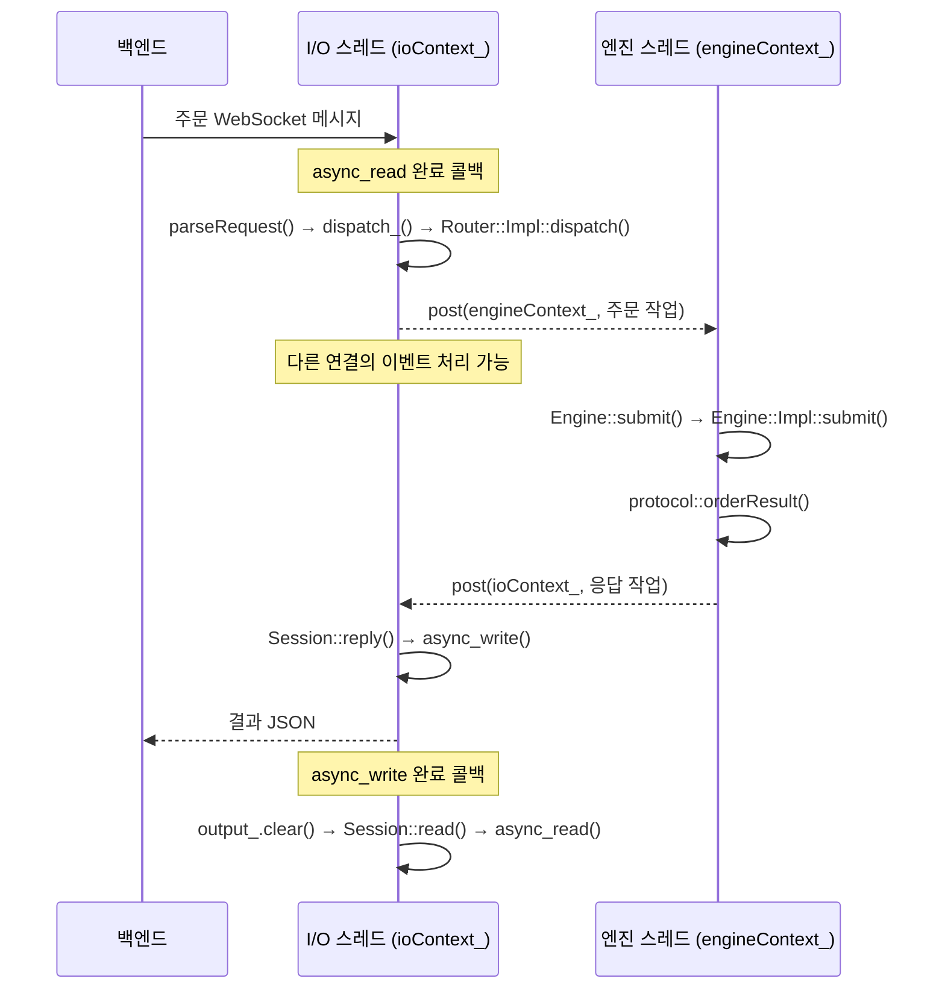

# WebSocket 라우터의 함수 호출과 실행 컨텍스트

이 문서는 현재 코드를 `main()`부터 따라가며 **어느 함수가 어느 스레드에서 실행되고,
다음 작업을 어디에 등록하는지** 설명한다. 실행 명령과 JSON 요청·응답 예시는
[WebSocket 주문 라우터](websocket-router.md)를 참고한다.

주요 소스는 [서버 진입점](../app/server.cpp), [Router·Session 구현](../router/src/router.cpp),
[주문 JSON 처리](../router/src/order_protocol.cpp), [엔진 구현](../engine/src/engine.cpp)이다.

## 1. 먼저 구분할 것: 객체, 컨텍스트, 스레드

`Router`나 `Session` 객체 자체가 스레드는 아니다. **일반 함수 호출은 호출한 스레드에서
실행**된다. 다른 스레드에서 실행하려면 그 스레드가 소비하는 컨텍스트에 작업을 전달한다.

현재 실행 환경은 다음과 같다.

| 실행 주체 | 실행하는 함수 | 담당 작업 |
| --- | --- | --- |
| main 스레드 | `main()` | 설정, 객체 생성, 시작, 종료 신호 대기, 종료 요청 |
| I/O 스레드 `ioThread_` | `ioContext_.run()` | 연결·수신·송신 완료 콜백, JSON 검증, 종목 선택 |
| 엔진 스레드 `engineThread_` | `engineContext_.run()` | 전달된 주문·조회 처리, Engine::submit()/lastTradePrice(), 결과 JSON 생성 |

`io_context`는 비동기 작업과 완료 핸들러를 관리하는 실행 컨텍스트다. `run()`을 호출한
스레드가 해당 컨텍스트의 핸들러를 실행한다. 코드의 `ioContext_{1}`과
`engineContext_{1}`에 있는 `1`은 동시 실행에 관한 힌트이며, 스레드를 생성하지 않는다.
실제 스레드 생성은 `Router::Impl::start()`의 `std::thread(...)`에서 일어난다.

코드를 읽을 때 다음 세 가지를 구분하면 된다.

- `read()` 같은 일반 호출: 지금 실행 중인 스레드에서 바로 실행한다.
- `async_read(..., callback)` 같은 호출: 비동기 작업을 시작하고 반환한다.
  완료 콜백은 나중에 이 소켓의 실행 컨텍스트를 돌리는 I/O 스레드에서 실행된다.
- `net::post(context, callback)`: 지정한 컨텍스트에 작업을 넣는다.
  전달한 콜백을 그 자리에서 직접 실행하지 않으며, 호출한 스레드가 결과를 기다리지도 않는다.

`post()`는 현재 함수의 실행 스레드를 바꾸는 명령이 아니다. **람다 본문의 실행을 다른
컨텍스트에 맡기고, 현재 함수는 원래 스레드에서 계속 실행**한다. 다른 스레드가 람다를
실행하기 시작하는 시점과 현재 함수가 반환하는 시점은 겹칠 수 있다.

## 2. 초기화: `main()` → `Router()` → `Router::Impl()`

**실행 위치: main 스레드. 아직 작업 스레드는 없다.**

`main()`은 먼저 `RouterConfig`를 만들고 실행 인자의 주소·포트·종목 ID를 반영한다.
인자가 없다면 `127.0.0.1:9002`, `stockId=1001`을 사용한다.
이어 `pthread_sigmask()`로 `SIGINT`와 `SIGTERM`을 차단한다. 이후 만들어지는 작업
스레드도 이 설정을 이어받고, main이 나중에 `sigwait()`로 종료 신호를 받는다.

그다음 다음 코드가 실행된다.

```cpp
matching_engine::Router router{config};
```

생성 순서는 `Router::Router(config)` → `std::make_unique<Impl>(...)` →
`Router::Impl::Impl(config)`다. 이 과정에서 다음 멤버가 준비된다.

- `config_`: 서버 설정을 보관한다.
- `ioContext_`, `engineContext_`: I/O와 엔진 작업의 실행 컨텍스트를 각각 만든다.
- `ioWork_`, `engineWork_`: 일시적으로 작업이 없어도 각 컨텍스트의 `run()`이
  끝나지 않도록 유지하는 work guard다. 작업이 없을 때 CPU를 계속 소모하며 도는 의미는 아니다.
- `acceptor_{ioContext_}`: I/O 컨텍스트에 연결된 TCP 연결 수락 객체다.
- `acceptRetry_{ioContext_}`: 연결 수락 실패 후 재시도에 사용하는 타이머다.
- `engine_(config_.stockId)`: 한 종목을 담당하는 `Engine`을 만든다.

C++ 멤버는 클래스에 선언된 순서로 초기화된다. 생성자 본문에 보이는 한도 검사 전에
이 멤버 초기화가 이루어진다. `Engine` 생성도 이 시점에는 main 스레드에서 일어나지만,
서버 실행 중 주문 처리는 엔진 Worker만 수행한다.

이 단계에서는 객체와 설정만 준비됐다. 아직 포트에 바인딩하지 않았고,
WebSocket 메시지를 받지도 않는다.

## 3. 서버 시작: `Router::start()` → `Router::Impl::start()`

**진입 위치: main 스레드. 이 함수 안에서 두 작업 스레드를 만든다.**

`main()`의 `router.start()`는 `impl_->start()`를 호출한다. `Router::Impl::start()`는
한 번만 시작할 수 있는지 검사한 뒤 다음 순서로 서버를 준비한다.

1. `make_address()`와 `Tcp::endpoint`로 바인딩할 주소·포트를 만든다.
2. `acceptor_.open()`으로 리스닝 소켓을 연다.
3. `acceptor_.set_option(reuse_address(true))`로 주소 재사용 옵션을 설정한다.
4. `acceptor_.bind()`로 소켓에 주소·포트를 연결한다.
5. `acceptor_.listen()`으로 TCP 연결 대기를 시작한다.
6. `acceptor_.local_endpoint().port()`로 실제 포트를 `port_`에 기록한다.
7. `Router::Impl::accept()`를 호출해 첫 번째 비동기 연결 수락을 등록한다.
8. 두 `std::thread`를 만들고 각각의 컨텍스트를 실행한다.

```cpp
accept(); // 첫 호출은 main 스레드: 연결 수락 작업을 등록
engineThread_ = std::thread([this] { engineContext_.run(); });
ioThread_ = std::thread([this] { ioContext_.run(); });
```

`listen()`은 TCP 연결을 받을 준비를 하고, `accept()`는 연결 수락 작업과 완료 콜백을
등록한다. **이 콜백의 실행은 I/O 스레드가 `ioContext_.run()`을 돌리면서 시작된다.**
엔진 스레드는 아직 주문이 없으므로 작업을 기다린다.

시작에 성공하면 `running_ = true`로 설정하고 main으로 반환한다. main은 주소를 출력한 뒤
`sigwait()`에서 종료 신호를 기다린다. 연결과 주문 처리는 그동안 두 작업 스레드가 담당한다.
주소 오류·포트 충돌 같은 시작 실패는 예외로 main에 전달된다.

## 4. 연결 수락: `Router::Impl::accept()` → `Session::start()`

**최초 `accept()` 호출은 main, 연결 완료 콜백과 이후 `accept()` 호출은 I/O 스레드다.**

`Router::Impl::accept()` 안에는 `acceptor_.async_accept(...)`가 있다.
백엔드가 TCP로 접속하면 완료 콜백이 연결된 `Tcp::socket`을 전달받는다.

콜백은 종료 중인지와 연결 한도를 확인한 뒤 연결 하나를 담당하는 `Session`을 만든다.
이 소켓은 I/O 컨텍스트에 연결되어 있으므로, 이를 감싼 WebSocket의 비동기 작업도
같은 I/O 컨텍스트에서 완료 핸들러를 실행한다.

`Session` 생성자에는 소켓·메시지 크기 한도 외에 두 함수가 전달된다.

```cpp
// Session::dispatch_에 보관: 파싱한 주문 또는 조회 요청을 Router로 전달
[this](protocol::IncomingRequest request, std::weak_ptr<Session> client) {
    dispatch(std::move(request), std::move(client));
}

// Session::onClose_에 보관: 닫힌 연결을 Router의 관리 목록에서 제거
[this](const std::shared_ptr<Session>& client) {
    sessions_.erase(client);
}
```

따라서 `Session`의 `dispatch_()` 호출은 이 람다를 거쳐 `Router::Impl::dispatch()`로
이어진다. 이 일반 콜백 호출 자체는 아직 스레드 경계를 넘지 않는다.

`Session::Session()`은 소켓을 `ws_`에 넣고 서버용 WebSocket 타임아웃,
최대 수신 메시지 크기, 응답의 text 모드를 설정한다.
Router는 생성한 Session을 `sessions_`에 보관하고 `session->start()`를 호출한다.

여기에는 서로 다른 두 `async_accept()`가 등장한다.

- `acceptor_.async_accept()`: TCP 연결을 받아 연결 소켓을 얻는다.
- `Session::start()`의 `ws_.async_accept()`: 그 연결에서 HTTP Upgrade 요청을 처리해
  WebSocket 핸드셰이크를 수행한다.

TCP 연결이 만들어졌다는 것만으로 주문 JSON을 받기 시작하는 것은 아니다.
**WebSocket 핸드셰이크 완료 콜백이 성공해야 `Session::read()`를 호출한다.**
실패하면 `Session::stop()`으로 연결을 정리한다.

한편 Router의 TCP 연결 완료 콜백은 다음 `accept()`도 등록한다.
앞선 연결의 핸드셰이크가 끝나기를 기다리지 않으므로 여러 연결을 받을 수 있다.
연결 한도 초과 시 새 소켓을 닫고, TCP accept 오류 시 100ms 타이머 후 재시도한다.

## 5. 요청 수신: `Session::read()` → `protocol::parseRequest()`

**실행 위치: I/O 스레드.**

`Session::read()`는 종료된 연결인지 확인하고 다음 수신을 시작한다.

```cpp
ws_.async_read(input_, [self = shared_from_this()](ErrorCode ec, std::size_t) {
    // 수신 완료 후 I/O 스레드에서 실행할 처리
});
```

`async_read()`를 호출한 함수는 수신 완료까지 대기하지 않고 반환한다.
I/O 스레드는 다른 연결의 완료 콜백도 처리할 수 있다.

여기서 애플리케이션이 처리하는 단위는 **완성된 WebSocket 메시지 하나**다.
TCP 패킷이나 WebSocket fragment 하나마다 JSON을 파싱하는 구조가 아니다.
Beast가 분할된 메시지를 조립하면 완료 콜백이 실행된다.

수신 완료 콜백은 다음 순서로 진행된다.

1. 통신 오류 또는 닫힌 연결이면 `Session::stop()` 후 반환한다.
2. `ws_.got_text()`로 text 메시지인지 확인한다.
3. `buffers_to_string(input_.data())`로 수신 내용을 문자열 `payload`로 복사한다.
4. `input_.consume(input_.size())`로 사용한 입력 버퍼 내용을 비운다.
5. binary 메시지면 `protocol::error()` → `reply()`로 `TEXT_REQUIRED`를 응답한다.
6. text 메시지면 `protocol::parseRequest(payload)`를 호출한다.
7. 파싱에 성공하면 `dispatch_(std::move(request), self)`로 Router에 전달한다.

`protocol::parseRequest()`도 같은 I/O 스레드에서 동기 실행된다. JSON 구문·중첩 깊이,
BUY/SELL은 일곱 필드와 status=PENDING을, GET_CURRENT_PRICE는 type·stockId 두 필드를 검사한다.
내부 `integer()`는 소수나 int64 범위 초과 값을 정수로 잘못 변환하지 않도록 검사한다.

성공 결과 IncomingRequest는 IncomingOrder 또는 CurrentPriceRequest를 담는 variant다.
IncomingOrder에는 stockId와 OrderRequest가, CurrentPriceRequest에는 stockId가 들어 있다.
실패하면 `PacketError`를 던지고, 수신 콜백이 이를 잡아 `reply()`로 오류 JSON을 보낸다.
이 오류 경로는 엔진 컨텍스트까지 가지 않는다.

## 6. 컨텍스트 전달: `Router::Impl::dispatch()` → 엔진 작업 큐

**함수 진입은 I/O 스레드, `post()`에 전달한 람다 본문은 엔진 스레드다.**

`Session::dispatch_()`가 호출한 `Router::Impl::dispatch()`는 먼저
std::visit으로 요청의 stockId를 꺼내 등록된 config_.stockId와 비교한다.
다르면 I/O 스레드에서 `UNKNOWN_STOCK`을 응답하고 끝낸다.

종목이 맞으면 다음 부분에서 엔진 작업을 전달한다.

```cpp
net::post(engineContext_, [this, request = std::move(request), client = std::move(client)] {
    // 여기부터는 engineContext_.run()을 실행하는 엔진 스레드
});
```

request는 이동 캡처하므로 수신 콜백의 지역변수가 사라져도 요청 데이터가 유지된다.
`client`는 응답할 Session을 가리키는 `weak_ptr`다.

현재 구현의 스레드 간 주문 큐는 `engineContext_`의 작업 큐다.
직접 구현한 `std::queue`나 호가창 내부의 `deque`를 사용하는 것이 아니다.
I/O 스레드는 작업을 전달하고 자신의 이벤트 처리로 복귀한다.

## 7. 엔진 처리와 응답 컨텍스트 복귀

**실행 위치: 엔진 스레드.**

`engineContext_.run()`이 앞서 등록된 작업을 꺼내면 람다 안의 다음 코드가 실행된다.

```cpp
if (const auto* order = std::get_if<protocol::IncomingOrder>(&request)) {
    response = protocol::orderResult(*order, engine_.submit(order->request));
} else {
    response = protocol::currentPriceResult(engine_.stockId(), engine_.lastTradePrice());
}
```

BUY/SELL 주문의 실제 함수 흐름은 다음과 같다.

1. `Engine::submit(request)`가 내부 `Engine::Impl::submit(request)`를 호출한다.
2. `validate()`로 값과 중복 ID를 검사하고 `previewMatch()` 등으로 처리 용량을 확인한다.
3. 정상 주문은 `matchBuy()` 또는 `matchSell()`로 체결하고 남은 수량을 호가창에 넣는다.
4. `SubmissionResult`가 반환된다.
5. `protocol::orderResult(order, result)`가 상태·체결 수량·체결 목록을 JSON 문자열로 만든다.

현재가 조회는 Engine::lastTradePrice()를 읽고 protocol::currentPriceResult()로 응답한다.
조회는 엔진 상태를 변경하지 않으며, 최초 체결 전에는 price=null을 반환한다.

이 함수들은 모두 **같은 엔진 스레드에서 동기적으로 실행**된다.
`Engine::Impl`에 들어간다고 스레드가 다시 바뀌지 않는다. 결과 JSON 직렬화도 현재는
엔진 스레드에서 수행한다. 엔진의 입력 검증 거절 역시 `SubmissionResult`를 통해 정상
응답 경로로 전달되며, 처리 중 `std::exception`이 발생하면 `INTERNAL_ERROR` JSON을 만든다.

이후 두 번째 `post()`가 실행된다.

```cpp
net::post(ioContext_, [client, response = std::move(response)]() mutable {
    // 이 람다는 다시 I/O 스레드에서 실행
    if (const auto session = client.lock()) {
        session->reply(std::move(response));
    }
});
```

엔진 스레드는 결과 문자열을 I/O 컨텍스트로 넘기고 다음 엔진 작업을 처리할 수 있다.
람다가 코드상 엔진 람다 안에 중첩되어 있어도, 실행 위치는 `post()`의 목적지인
`ioContext_`에 의해 결정된다.

I/O 스레드에서 `client.lock()`이 성공하면 해당 연결의 `reply()`를 호출한다.
Session이 이미 소멸했다면 응답을 보내지 않는다. Session이 남아 있지만 닫혔다면
`reply()`의 `closed_` 검사에서 반환한다. 이런 경우에도 이미 실행된 엔진 작업은 취소되지 않는다.

## 8. 응답 전송: `Session::reply()` → 다음 `Session::read()`

**실행 위치: I/O 스레드.**

`reply(response)`는 결과 문자열을 멤버 `output_`에 보관한 뒤
`ws_.async_write(net::buffer(output_), ...)`를 호출한다.
비동기 전송이 끝날 때까지 버퍼가 살아 있어야 하므로 지역변수 대신 멤버에 보관한다.

송신 완료 콜백에서는 오류가 있으면 `stop()`을 호출하고, 성공하면 `output_.clear()` 후
`read()`를 다시 호출한다. 이 성공은 WebSocket 쓰기 작업의 완료를 뜻하며,
상대 백엔드의 JSON 처리나 DB 저장 완료를 확인하는 응답은 아니다.

따라서 연결 하나의 반복 흐름은 다음과 같다.



같은 연결은 응답 전송이 끝나야 다음 애플리케이션 수신을 등록한다. 이미 도착한 후속 데이터는
소켓이나 라이브러리 버퍼에 대기할 수 있지만, 다음 주문 처리를 바로 시작하지는 않는다.
이 방식으로 연결별 요청·응답 순서를 유지하고 동시에 여러 쓰기를 시작하지 않는다.

각 단계는 비동기 작업을 등록하고 반환하므로, 이 반복은 한 함수의 재귀 호출 스택이
계속 쌓이는 구조가 아니다. 별도 연결은 각자의 `Session`과 버퍼를 가지고 같은
I/O 스레드에서 처리되며, 연결마다 스레드를 새로 만들지 않는다.

## 9. 연결 객체가 콜백 실행 중 살아 있는 이유

Router의 `sessions_`는 활성 Session을 `shared_ptr`로 소유한다.
Session의 비동기 콜백도 `[self = shared_from_this()]`로 자신을 붙잡는다.
그래서 소켓 작업이 아직 진행 중일 때 Session과 `input_`·`output_`가 먼저 해제되지 않는다.

`Session::stop()`은 I/O 스레드에서 `closed_`를 설정하고 TCP 소켓을 닫은 다음
`onClose_()`를 호출해 `sessions_`에서 자신을 제거한다.
남은 비동기 콜백이 정리되고 마지막 `shared_ptr`가 사라지면 실제 객체가 소멸한다.

엔진 작업은 Session을 `weak_ptr`로만 참조한다. 주문 처리를 위해 연결 객체의 수명을
억지로 연장하지 않고, 응답 시점에 연결 객체가 남아 있는지 확인하는 구조다.
피어의 실제 연결 단절은 후속 I/O 완료 시점에 발견될 수도 있으므로 `lock()` 성공 자체가
상대 백엔드가 아직 연결되어 있음을 보장하지는 않는다.

## 10. 종료: `Router::stop()`이 스레드와 컨텍스트를 정리하는 순서

**종료의 출발점은 main 스레드이고, 소켓 정리는 I/O 스레드에서 수행한다.**

1. main의 `sigwait()`가 `SIGINT` 또는 `SIGTERM`을 받으면 `router.stop()`을 호출한다.
2. `Router::stop()` → `Router::Impl::stop()`은 I/O 컨텍스트에 종료 작업을 `post()`한다.
3. I/O 스레드의 종료 작업이 `stopping_ = true`로 바꾸고 `acceptor_`를 닫는다.
   `acceptRetry_`도 취소해 다음 연결 수락을 막는다.
4. 같은 종료 작업에서 모든 Session의 `stop()`을 호출해 소켓을 닫는다.
   이미 수신 완료 콜백이 대기 중이어도 `closed_` 검사로 추가 주문 처리를 막는다.
5. 이어 `engineWork_.reset()`을 호출한다. 엔진 컨텍스트를 즉시 중단하는 것이 아니라,
   기존 큐의 작업을 모두 처리하면 `engineContext_.run()`이 끝날 수 있도록 한다.
6. main은 `engineThread_.join()`으로 그 완료를 기다린다.
   이 기간에도 I/O 스레드는 동작하며 엔진의 응답 작업을 받아 정리할 수 있다.
7. 엔진 스레드가 끝난 뒤 main이 `ioWork_.reset()`을 호출한다.
   남은 응답 작업과 취소된 소켓의 완료 콜백 등이 정리되면 `ioContext_.run()`도 끝난다.
8. main이 `ioThread_.join()`을 완료하고 `running_ = false`로 설정한다.

종료 작업을 I/O 컨텍스트에 먼저 넣는 이유는 입력 콜백과 소켓 정리를 같은 스레드에서
순서대로 처리하기 위해서다. 엔진이 응답을 I/O 컨텍스트에 보내는 동안 그 컨텍스트가
살아 있어야 하므로 엔진 스레드를 먼저 join한다.

연결을 먼저 닫으므로 종료 중 응답 전달은 보장하지 않는다. 종료 작업 이전에 엔진 큐로
전달한 주문은 처리하지만, 소켓 버퍼에만 남아 있던 후속 주문까지 처리하지는 않는다.
`Router`가 소멸할 때도 `Impl` 소멸자가 `stop()`을 호출하며, 이미 정지했다면 바로 반환한다.

현재가 요청·응답과 오류 규칙은 [현재가 조회 기능](current-price.md)을 참고한다.
