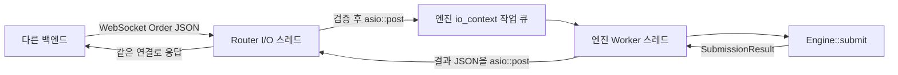

# WebSocket 주문 라우터

초기화부터 연결·수신·매칭·응답·종료까지 함수와 실행 컨텍스트를 따라가는 설명은
[라우터 실행 흐름](websocket-router-flow.md)에 정리되어 있습니다.
백엔드 연동용 전체 요청·응답 JSON과 타입·오류 코드 표는
[백엔드 JSON 통신 명세](backend-json-api.md)를 참고하세요.

## 실행과 기본 설정

```bash
cmake --preset dev
cmake --build --preset dev
./build/dev/app/matching_engine_server
```

- 주소: `ws://127.0.0.1:9002/`
- 등록 종목: `1001` (빈 호가창으로 시작)
- 라이브러리: Boost.Beast/Asio, nlohmann/json
- 요청 한도: WebSocket 메시지 하나당 16 KiB
- 연결 한도: 미완료 핸드셰이크를 포함해 128개
- 메시지 유형: UTF-8 JSON text, 메시지 하나에 주문·취소·조회 요청 중 하나

`matching_engine_server [address [port [stockId]]]`로 기본값을 바꿀 수 있습니다.
다른 호스트의 백엔드에서 접속하려면 적절한 인터페이스 주소나 `0.0.0.0`으로
실행합니다. `RouterConfig`에서는 메시지·연결 한도도 조절할 수 있습니다.
라이브러리의 포트 `0`은 테스트를 위한 임시 포트 선택이며, 실행 파일에서는 양수 포트를 받습니다.

## 스레드와 소유권



`Router`가 두 실행 컨텍스트와 두 작업 스레드를 소유합니다.
`main`은 별도로 `sigwait()`에서 종료 신호만 기다립니다. 따라서 서버 프로세스는
**작업 스레드 2개 + 대기 중인 main 스레드 1개**로 구성됩니다.

I/O 스레드는 accept, WebSocket handshake, read/write, JSON 파싱·검증과 종목 선택을
담당합니다. 엔진 스레드만 `Engine::submit()`, `Engine::cancel()`, `Engine::lastTradePrice()`를 호출합니다. 코어 엔진의 동기 API와
자료구조는 그대로이며, 엔진을 여러 스레드에서 공유하지 않습니다.

한 연결에서는 `수신 → 엔진 처리 → 응답 전송 완료 → 다음 수신`을 반복합니다.
다른 연결은 그동안 독립적으로 처리되며 I/O 스레드가 엔진 결과를 기다리며 블로킹하지
않습니다. 연결마다 엔진 작업이 최대 하나이고 연결 수에도 한도가 있어 엔진 대기 작업이
무제한 쌓이지 않습니다. TCP의 흐름 제어가 빠른 송신자에게 역압을 전달합니다.

같은 연결의 주문은 전송 순서를 유지합니다. 서로 다른 연결 사이에서는 단일 I/O
스레드가 검증을 마치고 작업 큐에 넣은 순서가 엔진 접수 순서입니다. 클라이언트 시각이나
여러 연결의 실제 네트워크 도착 시각을 기준으로 전역 순서를 보장하지 않습니다.

## 주문 요청

ERD `Order`의 일곱 필드를 그대로 사용합니다. 추가 필드, 배열, 누락된 필드는 거절합니다.
신규 주문이므로 `status`는 반드시 `PENDING`입니다.

```json
{
  "orderId": 2001,
  "userId": 20,
  "stockId": 1001,
  "status": "PENDING",
  "quantity": 7,
  "price": 10100,
  "type": "SELL"
}
```

이후 다른 연결 또는 같은 연결에서 매수 주문을 보낼 수 있습니다.

```json
{
  "orderId": 1001,
  "userId": 10,
  "stockId": 1001,
  "status": "PENDING",
  "quantity": 3,
  "price": 10200,
  "type": "BUY"
}
```

| 필드 | 조건 |
| --- | --- |
| `orderId`, `userId` | 양수 signed int64 범위 JSON 정수 |
| `stockId` | 등록된 종목 ID (기본 `1001`) |
| `status` | `PENDING` |
| `quantity`, `price` | 1부터 `INT32_MAX`까지 JSON 정수 |
| `type` | `BUY` 또는 `SELL`, 대소문자 구분 |

문자열 숫자, 소수, 불리언과 int64 범위 초과 숫자를 정수로 자동 변환하지 않습니다.
양수·가격·수량 범위와 중복 주문 ID 검사는 기존 엔진이 수행합니다.
`price`는 지정가이고 체결 가격은 기존 대기 주문의 가격입니다.
JavaScript 백엔드는 큰 bigint ID를 `Number`로 변환하면 정밀도를 잃을 수 있으므로
정수를 보존하는 직렬화/파서를 사용하거나 ID를 안전 정수 범위로 제한해야 합니다.

## 현재가 조회 요청

~~~json
{"type":"GET_CURRENT_PRICE","stockId":1001}
~~~

응답은 CURRENT_PRICE event에 stockId와 price를 포함하며 최초 체결 전 가격은 null입니다.
조회는 type과 stockId 두 필드만 받고 주문과 같은 Worker에서 처리합니다.
자세한 검증 규칙과 사용법은 [현재가 조회 기능](current-price.md)을 참고하세요.

## 주문 취소 요청

```json
{"type":"CANCEL_ORDER","stockId":1001,"orderId":2001,"userId":20}
```

네 필드만 허용합니다. 매수·매도 구분 없이 본인 주문의 미체결 잔량 전체를 취소합니다.
`quantity`를 통한 일부 잔량 취소는 지원하지 않습니다. 이미 체결된 수량은 유지합니다.
취소도 엔진 Worker에서 `Engine::cancel()`을 호출하고, 다음 형식으로 응답합니다.

```json
{
  "event": "CANCEL_RESULT",
  "orderId": 2001,
  "stockId": 1001,
  "success": true,
  "canceledQuantity": 4,
  "failureReason": "NONE"
}
```

위 예시는 매도 7주 중 3주 체결 후 나머지 4주를 취소한 경우입니다.
실패 시 `success=false`, `canceledQuantity=0`이며 `failureReason`으로
`INVALID_ORDER_ID`, `INVALID_USER_ID`, `ORDER_NOT_FOUND`, `NOT_OWNER`,
`ALREADY_FILLED`, `ALREADY_CANCELED` 중 하나를 반환합니다.
취소는 마지막 체결 가격을 바꾸지 않으며 DB·자산 예약 해제는 백엔드의 책임입니다.

## 주문 응답

위 매도 주문 뒤 매수 주문의 응답 예시입니다.

```json
{
  "event": "ORDER_RESULT",
  "orderId": 1001,
  "stockId": 1001,
  "accepted": true,
  "status": "COMPLETE",
  "engineStatus": "FILLED",
  "rejectionReason": "NONE",
  "filledQuantity": 3,
  "remainingQuantity": 0,
  "trades": [
    {
      "tradeId": 1,
      "buyOrderId": 1001,
      "sellOrderId": 2001,
      "price": 10100,
      "quantity": 3
    }
  ]
}
```

| 엔진 결과 | `accepted` | ERD `status` | `engineStatus` |
| --- | --- | --- | --- |
| 미체결 접수 | `true` | `PENDING` | `OPEN` |
| 부분 체결 | `true` | `PENDING` | `PARTIALLY_FILLED` |
| 전량 체결 | `true` | `COMPLETE` | `FILLED` |
| 엔진 거절 | `false` | `null` | `REJECTED` |

ERD에는 거절 상태가 없으므로 거절은 `status=null`과 `rejectionReason`으로 표현합니다.
예를 들어 이미 접수한 `orderId`는 `DUPLICATE_ORDER_ID`로 거절되며 재체결하지 않습니다.
거절된 주문은 ID를 수정 없이 다시 사용할 수 있지만, 접수된 주문의 ID는 재사용할 수 없습니다.
응답은 DB를 갱신하지 않으며 백엔드가 실제 주문 저장과 정산을 담당해야 합니다.

응답은 요청한 연결로만 전송합니다. 기존 매도 주문이 나중에 체결되어도 그 매도자의
연결에 별도 이벤트를 보내지는 않습니다. 이번 주문의 `trades`에는 양쪽 주문 ID가 담기지만,
상대 주문의 최신 상태를 방송하는 기능은 아직 없습니다.

## 패킷 오류

```json
{
  "event": "ERROR",
  "code": "UNKNOWN_STOCK",
  "message": "No engine registered for stockId"
}
```

- `INVALID_JSON`: JSON 구문 오류 또는 과도한 중첩(깊이 8 초과)
- `INVALID_ORDER`: 잘못된 필드 구성, 타입, enum, 정수 표현
- `INVALID_REQUEST`: 조회·취소의 필드 구성, ID 정수 표현 또는 stockId 범위 오류
- `UNKNOWN_STOCK`: 등록되지 않은 종목
- `TEXT_REQUIRED`: binary 메시지
- `INTERNAL_ERROR`: 엔진 처리 또는 결과 생성 중 예외; 주문 반영 여부가 불확실할 수 있음

패킷 오류 후에도 같은 연결에서 다음 요청을 보낼 수 있습니다. 응답은 요청 순서대로
오므로 ID 없는 패킷 오류도 해당 연결의 요청 순서로 대응시킬 수 있습니다.
메시지 크기 초과는 WebSocket close code `1009`로 연결을 닫고, 연결 한도 초과는
HTTP upgrade 이전에 TCP 연결을 닫습니다. 일반 close/ping/pong/fragment 처리는 Beast에 맡깁니다.

## 시작과 종료

`Router::start()`는 포트 바인딩 실패를 호출자에게 예외로 보고합니다.
같은 객체는 한 번만 시작할 수 있으며 재시작하려면 새 `Router`를 만듭니다.
`stop()`과 소멸자는 새 입력을 중단하고, 열린 연결을 닫고, 이미 큐에 전달된 엔진 작업을
처리한 뒤 두 스레드를 join합니다. `stop()`을 반복 호출해도 됩니다.
수명주기 함수는 한 제어 스레드에서 호출하며 동시 호출을 지원하지 않습니다.

서버 실행 파일의 `SIGINT`/`SIGTERM`도 이 종료 경로를 사용합니다. 종료 시 연결은
강제로 닫으며 응답 전달을 보장하지 않습니다. 연결 단절 시에도 큐에 접수된 주문은
계속 처리될 수 있습니다. 미수신 응답을 실패로 단정하거나 새 주문 ID로 무조건 재시도하면
중복 주문이 될 수 있습니다. 현재 주문 결과 재조회 API, 영속화와 재시작 복구는 없습니다. 현재가 조회로 주문 성공 여부를 판단할 수는 없습니다.

## 범위와 검증

현재는 단일 종목 BUY/SELL 접수, 주문 취소와 현재가 조회용 내부 연동 MVP입니다. TLS, 인증, 잔고·보유수량 검증,
DB 저장·정산, 기타 조회 WebSocket API, 다종목 라우팅과 알림 방송은 구현하지 않았습니다.
기본 바인딩은 로컬 주소이며 공개 인터넷 서비스로 배포하는 설정이 아닙니다.

`ctest --preset dev`는 기존 엔진 단위 테스트와 실제 loopback WebSocket 통합 테스트를
실행합니다. 통합 테스트는 두 연결 간 체결, 부분 체결, 중복 ID, FIFO, 동시 요청,
정수 범위, 오류 이후 연결 재사용, binary, fragmentation, ping, 연결/메시지 한도,
미완료 핸드셰이크, 포트 충돌, 종료와 재바인딩을 확인합니다. 취소 검증에는 미체결·부분 체결
잔량 취소, 소유자·상태 검사, 잘못된 입력, 주문 직후 취소와 체결 경합이 포함됩니다.

구현 참고: [Boost.Beast 비동기 WebSocket 예제](https://github.com/boostorg/beast/blob/boost-1.83.0/example/websocket/server/async/websocket_server_async.cpp),
[nlohmann/json 값 변환 API](https://json.nlohmann.me/api/basic_json/get/).
